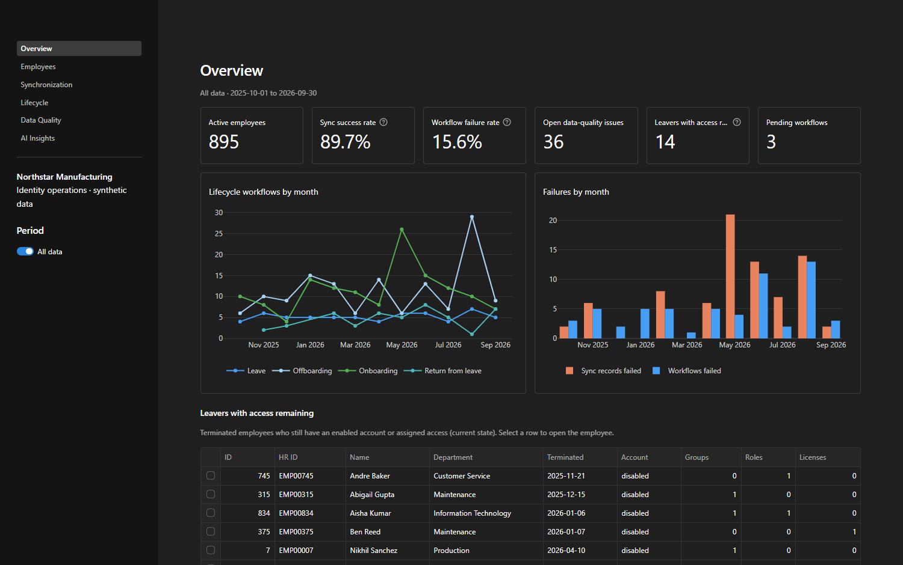
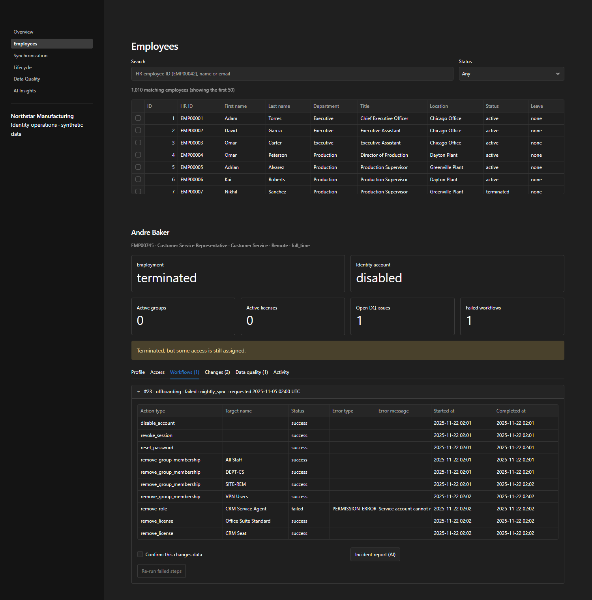
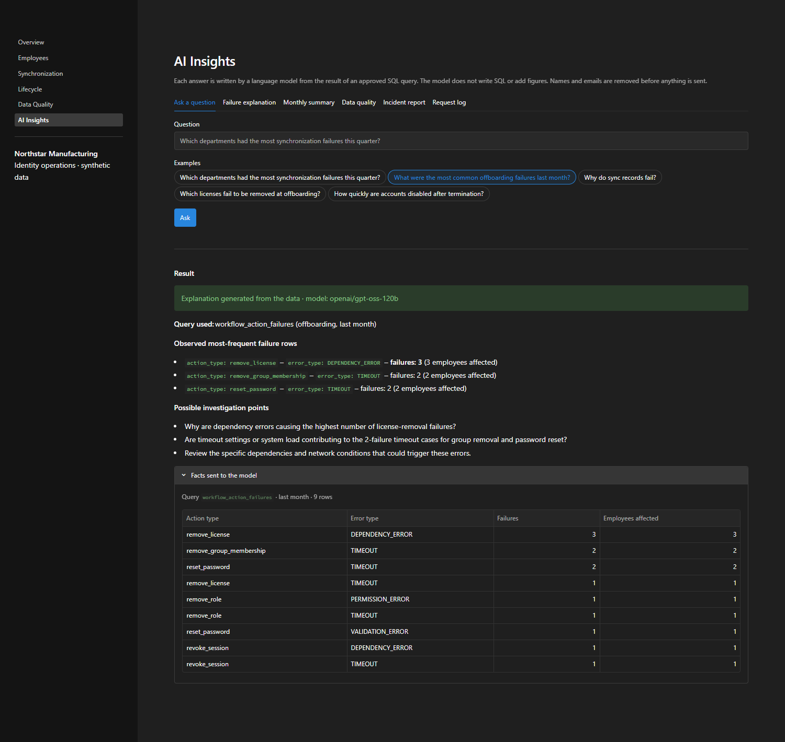
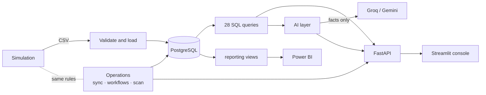

# Workforce Identity & Lifecycle Analytics Platform

An identity operations platform for a fictional manufacturer, Northstar Manufacturing. It simulates
a year of HR-driven identity work: attribute sync, onboarding, offboarding, leave and return,
access cleanup, failures and bad HR data. You can investigate and run those operations through an
API and an operations console, and a language model explains the numbers, but only from facts the
database computed.



> **All data is synthetic.** The company, its ~1,000 employees and its systems are invented. In a
> previous IAM role I automated these lifecycle operations with PowerShell (attribute sync from an
> HR export, offboarding cleanup, leave and return handling). This project rebuilds the concepts in
> Python. No employer code, data or infrastructure is used.

## What it does

| Part | What it is | Detail |
|---|---|---|
| Simulation | A deterministic, day-by-day year of identity operations for ~1,000 employees: nightly syncs, lifecycle workflows, failures (timeouts, permission errors, license shortages) and data-quality problems | [data-generation.md](docs/data-generation.md) |
| Database and analytics | PostgreSQL with Alembic migrations. 28 named SQL queries, each checked against an independent Python calculation | [data-model.md](docs/data-model.md), [analytics.md](docs/analytics.md) |
| Operations API | FastAPI: look up an employee's access and history, enter HR changes, run the sync, re-run failed workflows, run the data-quality scan | [operations.md](docs/operations.md) |
| Operations console | Streamlit, six pages, reads everything through the API | [screenshots below](#screenshots) |
| Reporting | A four-page Power BI report on a `reporting` schema of views, behind a read-only login. The model, Power Query and 38 DAX measures are stored as text | [powerbi/README.md](powerbi/README.md) |
| AI explanations | Questions mapped to approved queries; Groq with a Gemini fallback; personal fields removed; every number in an answer checked against the facts; works without a key | [ai.md](docs/ai.md), [real examples](docs/ai-examples.md) |
| Deployment | Azure Container Apps with a Neon database, built to cost nothing; an AWS version (EC2, RDS, CloudFormation) as an alternative | [azure.md](docs/azure.md), [aws.md](docs/aws.md) |

## Screenshots

**Investigating a leaver.** The offboarding workflow failed on one step (`remove_role`,
PERMISSION_ERROR), so the account is disabled but a role is still assigned. The console flags it,
shows the failed step, and offers a re-run or an AI incident report.



**An AI answer next to the facts it was given.** The model explains the result of an approved SQL
query. It never writes SQL or supplies numbers of its own.



More: [synchronization](docs/images/synchronization.png) ·
[lifecycle](docs/images/lifecycle.png) · [data quality](docs/images/data-quality.png)

## Architecture



More diagrams (a sync run, an AI request, the deployment) are in
[docs/architecture.md](docs/architecture.md).

## Design decisions

- **One set of lifecycle rules.** The simulation that generated the year and the operations the API
  runs today share `app/lifecycle/`. When the rules were extracted, the generated dataset stayed
  byte-identical, which showed nothing changed in behaviour.
- **SQL computes, the model explains.** Every metric comes from a named query. The model receives the
  query's rows with names and emails removed, and its answer is flagged `needs_review` if it contains
  a number that isn't in those rows.
- **Honest about what synthetic data can show.** Some patterns are built into the simulation, for
  example license removal failing more often than group removal. The console and the docs call these
  associations, not findings.
- **Free to run.** The deployment uses only services with free allowances that don't expire. The
  trade-offs against a production setup are listed in [azure.md](docs/azure.md#trade-offs-and-what-production-would-use-instead).
- **Tests that can't pass by skipping.** CI runs the suite against a real PostgreSQL service and fails
  if the database or the Bicep compiler is missing, instead of quietly skipping those tests.

## Run it locally

Requirements: Python 3.12+, Docker.

```bash
python -m venv .venv
.venv\Scripts\activate            # Windows  (source .venv/bin/activate on macOS/Linux)
pip install -r requirements-dev.txt

cp .env.example .env               # then set a password in .env
docker compose up -d               # PostgreSQL 16 on localhost:5432

alembic upgrade head               # create the schema
python scripts/generate_data.py    # write data/raw/*.csv
python scripts/load_data.py        # validate and load into PostgreSQL

uvicorn app.main:app --reload      # API docs at http://127.0.0.1:8000/docs
streamlit run streamlit_app/app.py # in a second terminal: console at http://localhost:8501
```

Or run the API and console in containers, using the same image as the cloud deployment:

```bash
docker compose --profile app up -d --build   # console at http://localhost:8501
```

AI keys (`GROQ_API_KEY`, `GEMINI_API_KEY`) are optional; without them the AI pages show the computed
data only. To deploy, see [docs/azure.md](docs/azure.md).

## Tests

```bash
pytest
```

The tests cover the rules, the generated data, loading, every query, the operations against
PostgreSQL, the API, the AI layer (with the models replaced by a fake), every console page, and the
deployment templates. See the table in [docs/architecture.md](docs/architecture.md#tests). Database
tests use a separate `workforce_test` database and are skipped locally if PostgreSQL isn't running.
GitHub Actions runs everything on every push.

## Limitations

- The data is synthetic, so the analysis shows what the simulation's assumptions produce, not how a
  real organisation behaves.
- The console has no sign-in. The deployment restricts it to one IP address, which suits a
  single-user demo, not a team.
- AI explanations are drafts for a person to read. The grounding check verifies numbers, not meaning.
- The deployed apps scale to zero, so the first request after a quiet period takes 10–30 seconds.
- The Power BI report needs Power BI Desktop to open (free, Windows only).

## Project layout

```
app/
  core/        configuration and logging
  db/          SQLAlchemy base and engine
  models/      database tables
  lifecycle/   shared rules: reference data, validation, sync rules, workflow plans,
               failure model and the workflow executor
  synthetic/   the year-long simulation and its assumptions
  etl/         CSV read/write, validation and loading
  analytics/   named SQL queries (sql/*.sql) and the query registry
  ai/          model clients (Groq, Gemini fallback), prompts, question routing,
               sanitizing and the grounding check
  services/    analytics, employee lookups, sync, workflow, data-quality and HR
               operations, and AI insights
  schemas/     Pydantic response models
  api/         FastAPI routers
  main.py      FastAPI application
streamlit_app/ Streamlit console: app.py (navigation), api.py (HTTP client),
               ui.py (shared tables, charts, filters), pages/
.streamlit/    console theme and server settings
alembic/       migrations
powerbi/       Power BI project, Power Query scripts, DAX measures, validation query
deploy/azure/  Bicep templates (Container Apps, Log Analytics, budget alert)
deploy/aws/    CloudFormation templates and instance start script (alternative)
.github/       CI: tests, image build
Dockerfile     one image for the API, the console and the jobs
scripts/       generate_data.py, load_data.py, create_reporting_user.py,
               capture_ai_examples.py, azure_deploy.py, aws_deploy.py
tests/
docs/          architecture, data model, analytics, operations, AI, deployment
```
