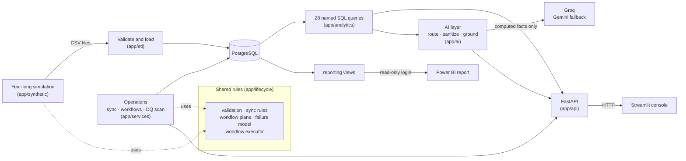
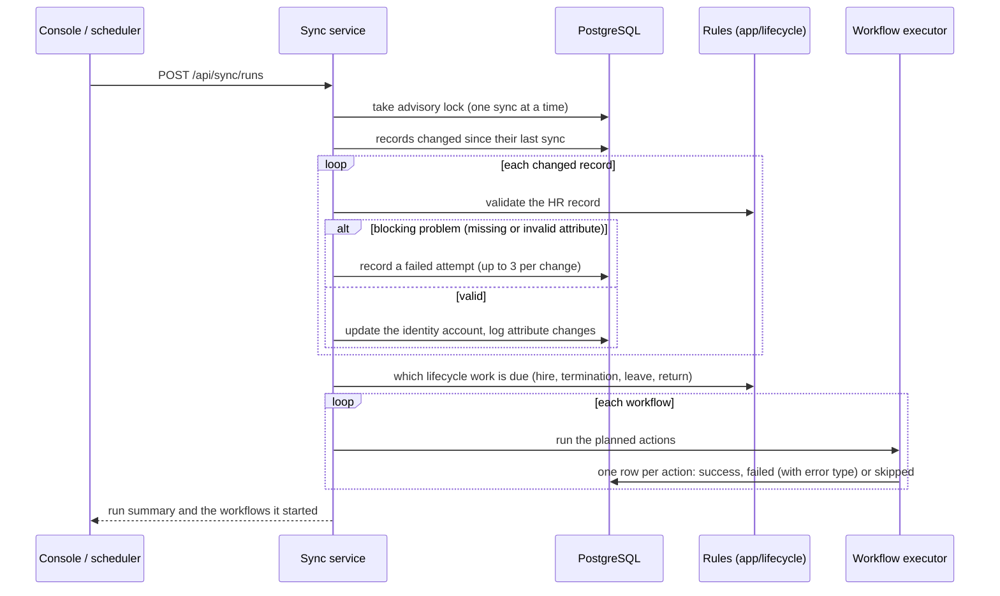
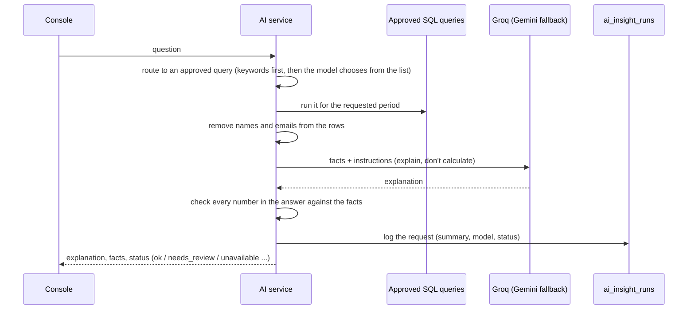
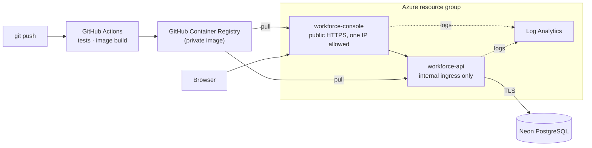

# Architecture

How the parts fit together. Each section links to the document with the detail.

## Components and data flow

- **One set of rules.** The simulation that generates the year of data and the operations the API
  runs today call the same code in `app/lifecycle/`. A sync run from the console behaves exactly
  like a nightly sync in the generated history. This was verified when the rules were extracted:
  the generated dataset stayed byte-identical. See [operations.md](operations.md).
- **Numbers come from SQL.** Every metric is a named query in `app/analytics/sql/`. The API, the AI
  layer and the tests use the same list, and each query is checked against an independent Python
  calculation. See [analytics.md](analytics.md).
- **The console has no database access.** It only calls the API, so the API is the single place
  where data is read and changed.
- **Power BI reads views, not tables.** A `reporting` schema of views (dimensions and facts) is the
  contract with the report, behind a read-only login. See [../powerbi/README.md](../powerbi/README.md).

## A sync run

What happens when the nightly sync runs, or someone presses **Run sync** in the console:

A failed workflow can be re-run from the console. The failed steps are re-planned against the
account's current state, so only work that is still outstanding runs, and the run is recorded as a
service-desk re-run. A re-run is refused if it no longer applies, for example an offboarding re-run
for someone who has been rehired.

## An AI request

Without an AI key, or when both models fail, the same request returns the computed facts and a
plain template, so nothing depends on a model being available. See [ai.md](ai.md), and
[ai-examples.md](ai-examples.md) for real outputs.

## Deployment

Both apps scale to zero, run at the smallest size, and fit Azure Container Apps' free monthly grant.
An AWS version (EC2 + RDS through CloudFormation) is kept as an alternative. See [azure.md](azure.md)
and [aws.md](aws.md).

## Tests

| Area | How it's tested |
|---|---|
| Rules and simulation | Unit tests of each rule; properties of the generated year (counts, ordering, no orphans) |
| Loading | CSV round trip, validation failures, reload replaces instead of appending |
| Analytics | Every query compared with an independent Python calculation over the same data |
| Operations | Sync, workflows, re-runs and the scan against PostgreSQL, each test in a rolled-back transaction |
| API | Endpoints over the test database, including errors and validation |
| AI | Routing, sanitizing, grounding, every degraded status and the fallback, with the models replaced by a fake |
| Console | Every page rendered with Streamlit's test runner against the API |
| Deployment | Templates linted and compiled; database privacy, network exposure, IAM scope and free-tier limits asserted |

CI runs all of it against a PostgreSQL service container on every push, and fails, rather than
skipping, if the database or the Bicep compiler is missing.
